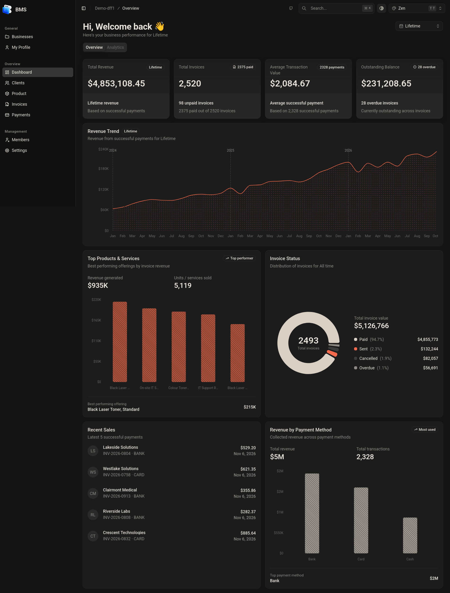
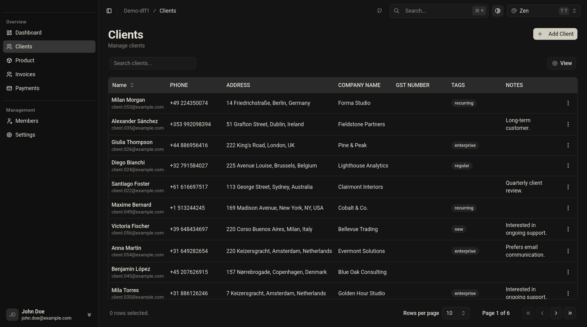
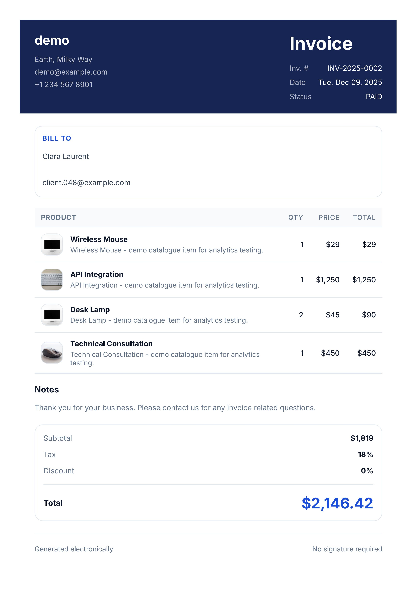

# Business Management System — Backend

Backend for a full-stack Business Management System. It provides APIs for managing businesses, team members, clients, products, invoices, and payments.

Built with Express, TypeScript, and MongoDB. Supports multiple businesses with separate data and member roles.

**Frontend:** [Bms Frontend](https://github.com/HeyNeerav/Bms-Frontend)

## Screenshots




## Tech Stack

- Node.js and TypeScript
- Express 5
- MongoDB and Mongoose
- JWT and Google OAuth
- Zod
- Cloudinary and Multer
- Resend
- Puppeteer and Handlebars
- Vitest and Supertest

## Features

- User authentication and Google login
- Multiple business management
- Team members and role-based access
- Client management
- Product and service management
- Invoice creation and PDF generation
- Payment tracking
- Business analytics
- Image uploads
- Search and pagination
- Automated tests

## Getting Started

### Requirements

- Node.js
- pnpm
- MongoDB replica set
- Cloudinary account
- Resend account

Google OAuth credentials are required if you want to use Google login.

### Installation

Clone the repository:

```bash
git clone https://github.com/NHeroOP/Bms-Backend.git
cd Bms-Backend
```

Install dependencies:

```bash
pnpm install
```

Create your environment file:

```bash
cp .env.example .env
```

Add the required environment variables to `.env`.

Start the development server:

```bash
pnpm run dev
```

## Docker

The repository includes Docker configuration for MongoDB and Mongo Express.

Create a MongoDB keyfile:

```bash
openssl rand -base64 756 > mongo-keyfile
chmod 400 mongo-keyfile
sudo chown 999:999 mongo-keyfile
```

Start the containers:

```bash
docker compose up -d mongo mongo-express
```

## Project Structure

```text
src/
├── modules/
│   ├── auth/
│   ├── users/
│   ├── businesses/
│   ├── business-members/
│   ├── clients/
│   ├── products/
│   ├── invoices/
│   ├── payments/
│   └── analytics/
├── shared/
├── env.ts
├── app.ts
└── server.ts
```

## API Routes

All routes use the `/api/v1` prefix.

| Route               | Description           |
| ------------------- | --------------------- |
| `/auth`             | Authentication        |
| `/users`            | User management       |
| `/businesses`       | Business management   |
| `/business-members` | Team management       |
| `/clients`          | Client management     |
| `/products`         | Products and services |
| `/invoices`         | Invoice management    |
| `/payments`         | Payment management    |
| `/analytics`        | Business analytics    |
| `/health`           | Health check          |

## Authentication and Business Access

Protected routes require a valid access token, sent through an HTTP-only cookie or the `Authorization` header.

Business-specific requests use the `x-business-id` header:

```http
x-business-id: <business-id>
```

The backend checks business membership and permissions before allowing access.

Available roles:

- `OWNER`
- `ADMIN`
- `EMPLOYEE`

## Testing

Run the test suite with:

```bash
pnpm run test
```

Uses Vitest, Supertest, and MongoDB Memory Server.
